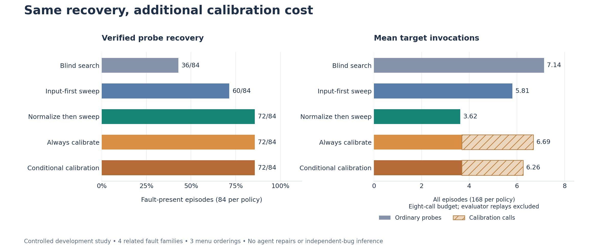
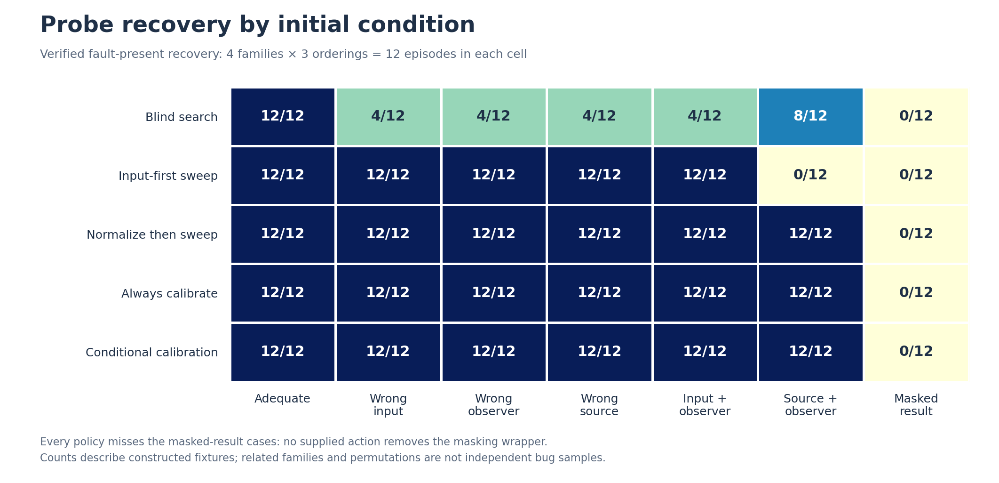
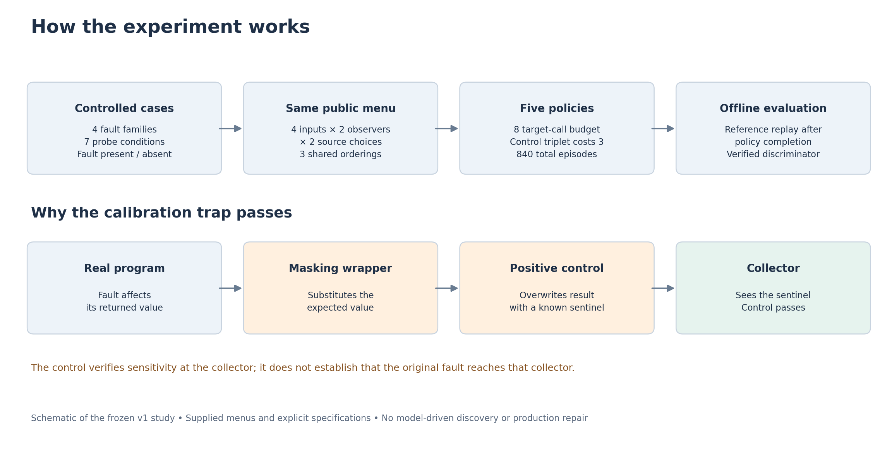

# Skylla

**Choose the next debugging experiment. Keep the evidence attached to its source.**

[](LICENSE)
[](pyproject.toml)
[](pyproject.toml)
[](docs/CLAIM_MATRIX.md)

Skylla is an open-source debugging experiment tool being developed for developers
and AI coding agents. Its local decision core works without a model provider or
agent harness. The research asks when to run an existing probe, improve the
experiment, or investigate another explanation under a fixed budget.

[Quick start](#quick-start) · [Capabilities](#current-capabilities) ·
[Findings](#latest-findings) · [Research](#research-and-documentation) ·
[Reproduce](#reproduce-the-work)

## Current capabilities

**An installable decision CLI and reproducible research tooling.**

| Capability | Available today |
| --- | --- |
| Experiment selection | Choose supplied candidates using declared contrasts and estimated cost |
| Menu expansion | Request bounded expansion when declared controls or distinctions are missing |
| Evidence checks | Flag mismatched state IDs and unverified or failed preconditions |
| Budget handling | Recommend unresolved when the declared budget or menu cannot support an action |
| Developer and agent interface | Python API and JSON CLI, including stdin input |
| Research artifacts | Pinned cases, executable probes, frozen protocols, observations, and verification scripts |

The controller recommends actions from caller-supplied contracts. Command
execution lives in separate study scripts; automatic experiment generation,
production-code repair, and native harness adapters remain planned. State IDs
and precondition checks depend on the integrating caller. See the
[controller contract](docs/CONTROLLER.md) for complete behavior and limitations.

## Quick start

Requires Python 3.9 or newer. The controller has no runtime dependencies.

```sh
git clone https://github.com/codebreaker77/Skylla.git
cd Skylla
python -m pip install .

skylla experiments/expansion/examples/missing-control.json --policy conditional
```

The example returns `expand` because a declared required control is missing.
Compare the fixed-menu policy:

```sh
skylla experiments/expansion/examples/missing-control.json --policy fixed
```

That returns `execute` for the existing candidate. These commands make local
decisions; the example's command vector is illustrative. Use `skylla -` to read a
request from stdin, or import `decide` from `skylla` in Python.

## Latest findings



The first controlled probe-repair study ran **840 episodes** across four original
fault families, seven probe conditions, two fault states, three menu orderings,
and five deterministic policies. They are related development fixtures, not
840 independent bugs or agent-repair attempts.

**Simple normalization matched calibration-based recovery with fewer target calls.**

| Policy | Verified recovery / 84 fault-present episodes | Mean calls across all 168 episodes |
| --- | ---: | ---: |
| Blind search | 36 / 84 | 7.14 |
| Input-first sweep | 60 / 84 | 5.81 |
| Normalize then sweep | **72 / 84** | **3.62** |
| Always calibrate | 72 / 84 | 6.69 |
| Conditional calibration | 72 / 84 | 6.26 |

Every policy missed the deliberately masked-result cases. A collector-sensitivity
control could pass while an upstream wrapper hid the actual faulty value.
The result supports retaining a cheap baseline; calibration did not earn its
extra call cost in this study. These are diagnostic results, with no measured
agent-repair improvement or established breakthrough. There is no published
Skylla paper yet.

[Frozen methodology](experiments/probe-repair/METHODOLOGY.md) ·
[Full report](experiments/probe-repair/REPORT.md) ·
[Episode records](experiments/probe-repair/results/run-001/episodes.jsonl) ·
[PNG and SVG figures](experiments/probe-repair/figures/README.md)

<details>
<summary><strong>See recovery by probe condition</strong></summary>



</details>

<details>
<summary><strong>See the study workflow and calibration blind spot</strong></summary>



</details>

## Research and documentation

| Start here | What it covers |
| --- | --- |
| [Research ideation](docs/IDEATION.md) | Experiment repair, prior-art pressure tests, and reproducible design counterexamples |
| [Claim matrix](docs/CLAIM_MATRIX.md) | What is implemented, measured, and still unproven |
| [Next study](docs/NEXT_STUDY.md) | Staged comparisons, decision gates, and a proposed route to a defensible advantage |
| [Literature](docs/LITERATURE.md) and [prior-art audit](docs/PRIOR_ART_AUDIT.md) | Related papers, overlap, reading depth, and evidence boundaries |
| [Harness comparison](docs/HARNESSES.md) | Claude Code, Cursor, Codex, OpenHands, and mini-swe-agent comparison arms |
| [Product direction](docs/DIRECTION.md) | Developer workflow, integration boundary, and model/harness independence |
| [Pilot protocol](docs/PILOT.md) and [paper plan](docs/PAPER.md) | Evaluation requirements, resource accounting, and publication evidence |

Earlier development work is preserved separately:

- [Public trajectory audit](experiments/trajectory-audit/REPORT.md): 15 genuine
  coding-agent traces across seven repositories, sampled before inspecting content.
  Thirty-eight reviewed runtime events show setup and evidence-handling issues;
  a missing-observer advantage remains unestablished. The
  [next comparison protocol](experiments/trajectory-audit/NEXT_COMPARISON.md)
  defines the development comparison and its pending execution prerequisites.
- [Historical rehearsal](experiments/rehearsal/README.md): 48 recorded executions
  across three historical bugs.
- [Expansion study](experiments/expansion/REPORT.md): 12 screened cases, 96 test
  processes across setup attempts, and 24 runtime probe executions. Ten cases
  reproduced the target buggy/fixed difference.

## Reproduce the work

The standard-library suite contains 23 tests covering controller decisions,
controlled-study apparatus, screening triage, and trajectory extraction.

```sh
python -m unittest discover -s tests -v
python tools/study/probe_repair/study.py verify --name run-001
python tools/study/probe_repair/study.py run --name reproduction --workers 3
```

Use a new run name to preserve existing observations. Figure generation has
optional plotting dependencies:

```sh
python -m pip install -r experiments/probe-repair/figures/requirements.txt
python tools/study/plot_probe_repair.py
```

Historical-study environments and commands are in their respective reports.
Raw logs and downloaded workspaces stay local under ignored directories;
tracked records preserve their hashes. Verifiers report which local logs are
available and check those alongside the committed artifacts.

## Contributing

Useful contributions include reproduced failures, portable probe execution,
stronger simple baselines, and harness adapters. Open an
[issue](https://github.com/codebreaker77/Skylla/issues) with the failing command,
environment, expected behavior, and a minimal example. Experimental changes
should record their method, full costs, and unresolved outcomes.

## Topics

`debugging` · `developer-tools` · `ai-agents` · `program-repair` ·
`reproducible-research` · `python` · `model-agnostic` · `harness-agnostic`

## License

Skylla's original code and artifacts use the [MIT license](LICENSE).
Third-party datasets, source code, and papers retain their own licenses.
