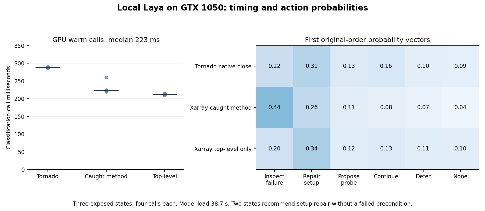

# Local System-1 shadow apparatus

October 13, 2026. The user selected local Laya only, without a Jev API, and
required GPU inference. No hosted Jev request was made. The first local CUDA
shadow run is complete: twelve decisions plus one separately recorded warmup.



## Available implementation

The optional adapter applies DeepEval's existing System-1 classifier interface
to five debugging actions plus its no-label option. A shared input contract
contains issue, state identity, remaining time and explicit runtime evidence.
The rules backend runs without optional dependencies. The local Laya bridge
maps the same SDK questions into Choice requests, recording exact provider state,
questions, typed probability answers, costs where exposed and failures.

This is an integration of existing primitives, not a novel judge. It recommends
actions in shadow mode and neither executes probes nor repairs production code.
The dependency-free Skylla controller is unchanged.

## Completed validation

- Real DeepEval 4.2.8 integration with a local stub passed three checks: a chosen
  action maps correctly, no-label output is retained, and a failure preserves no
  recommendation or sensitive exception text. Outbound socket connections were
  disabled during these checks. These are predetermined test outputs, not model
  predictions or accuracy measurements.
- Three development inputs were exported from the exposed Xarray/Tornado replay
  records. Only buggy runtime evidence enters the shadow examples; reference test
  outputs and patches are not exported. Issues and requirement-exercise flags
  are manually authored development context, not independent ground truth.
- Pure tokenizer checks using the actual SDK representation retain all six
  markers and identical full sequences at the selected limits. Tokens: Tornado
  native-close 456, Xarray caught-method 367, Xarray top-level 329. No weights or
  neural forward were used for these checks. Reversed action order will also be
  tested in the GPU run; this audit checks original order only.
- The pinned typed-decisions checkpoint was downloaded and all file hashes
  recorded; the large weight file matches its published LFS SHA-256. Weights and
  environment files remain ignored.
- Standard-library tests now include exhausted budgets, missing local model,
  prohibited top-level evaluator fields, non-finite budgets and strict CUDA-only
  behavior. A CUDA OOM is not retried on CPU.

The initial `integration.json` and `offline-records.json` are earlier development
records, preserved before the adapter's final instrumentation. Their adapter hash
identifies that earlier unarchived implementation; they do not certify the current
code. Use `integration-v2.json` for current-code integration verification. Original
state/probe provenance is checked separately. No historical artifact was overwritten.

## GPU configuration and measured results

Use PyTorch 2.6.0 CUDA 11.8, Laya 0.3.20 and Transformers 4.51.3 with checkpoint
revision `7b928d828b7b0e022f929d9bd2e44165aa270148`, typed-decisions only. Require the
GTX 1050's CUDA device, fp16 weights/autocast, max_len 1024 and head_max_len 256.
The bridge disables the pinned SDK's CPU retry path through its private inference
method; this integration must be revalidated before upgrading the SDK. CPU data
preparation/serialization is distinct from neural inference.

The run froze three states, original/reversed action order, two repetitions and
one separately recorded warmup before model loading. All twelve decisions and
warmup completed on `cuda:0`, with fp16 and CPU inference fallback disabled. A
separate CUDA float16 matrix-operation check also passed on the GTX 1050.

| Development state | Rules export | Laya, both action orders | Largest original probability |
| --- | --- | --- | ---: |
| Tornado native-close | Continue investigation | Repair setup | 0.3059 |
| Xarray caught-method | Inspect failure | Inspect failure | 0.4368 |
| Xarray top-level-only | Propose probe | Repair setup | 0.3393 |

Repetitions gave identical chosen actions; none of the six paired action-order
comparisons flipped the chosen action. This is three exposed states from two
bugs, not twelve independent tasks or evidence of general ordering robustness.
Full probability differences are retained in the post-run analysis.

Eight of twelve recommendations request setup repair with no failed precondition
in the supplied state. This violates the declared setup-action requirement on
two distinct examples; it is a contract observation, not an independent diagnosis
accuracy estimate. Rules agreement also is not ground-truth action utility.
Peak probabilities and SDK confidence measures were low. No confidence threshold
is fitted or promoted from these examples. Keep the model in shadow mode, review
the question/action taxonomy, and validate admissibility before executing any
future recommendation. No repairs were attempted or verified by this run.

The median warm classification-call time is **223.280 ms**, range 210.030-289.467
ms across twelve calls. It includes SDK classification/tokenization/inference/
postprocessing, excludes model load and classifier construction. Recorded model
load/verification time is **38.748 seconds**; complete timed runner interval is
**54.078 seconds** including imports, load, warmup and decisions. Package inventory,
dependency/model downloads, installation and report/plot generation are outside
that interval. Fixed ordering and repeated states prevent comparative speed claims.

The loader emitted a temperature warning: stored `choice:11+` temperature
0.10058 is outside its accepted range and was clipped to 0.5. That bucket is not
used by this six-option run, which uses `choice:6-10` temperature approximately
1.00002. Debugging-domain calibration remains unestablished regardless. The warning
was captured by the execution tool and annotated after inspecting the config;
the frozen script did not serialize loader stderr into its decision artifacts.

CUDA's ordinary full-file wheel transfer stalled. Byte-range download retries
completed and the wheel matched PyTorch's published SHA-256
`20cb297f45b11a0bf7ea12070b6d23a65905e7357ebb1800f66a71c52ddb52d9` before installation.
The pinned environment inventory and hashes are recorded. No CPU model inference
or hosted model calls were performed.

## Reproduction

See [methodology](METHODOLOGY.md) for dependencies and the information boundary.

```powershell
python tools/study/verify_shadow_apparatus.py
python tools/study/verify_laya_shadow.py
python tools/study/prepare_laya.py
artifacts/venvs/judge-baseline/Scripts/python.exe tools/study/run_laya_shadow.py --name laya-gpu-002
```

Run `prepare_laya.py` only when its recorded manifest is absent; use a new run
name for predictions. The current checkpoint manifest records original download
hashes; the bridge keeps SDK-normalized config copies in a separate local folder.
No large weights or third-party source are committed. The coding model/harness
for the eventual matched repair comparison remains unconfigured. Laya supplies
the small decision layer; it cannot generate the production patches by itself.

[Frozen run protocol](results/laya-gpu-001/protocol.json),
[all decisions](results/laya-gpu-001/decisions.json),
[summary](results/laya-gpu-001/summary.json), and
[post-run contract analysis](results/laya-gpu-001/analysis.json) preserve the full
development result. This is a functioning GPU integration with a weak initial
decision result, not a breakthrough or measured repair improvement.
