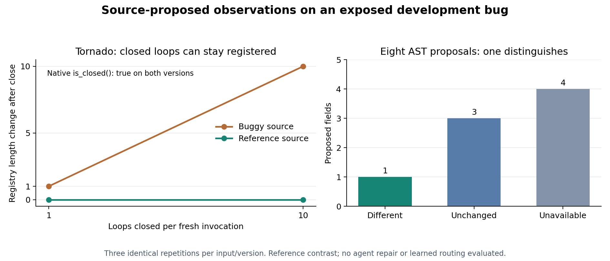

# Source-proposed observations on two exposed development bugs

October 13, 2026. Method/proposals frozen at commit `3b3d820` before execution.
This is a reference-version observation comparison, not the coding-agent repair
comparison. No Laya inference, adaptive policy or production patch was evaluated.



## Findings

The bounded AST generator supplied a distinguishing registry observation from
buggy Tornado source without a hard-coded registry field in the generator. The
native loop-closed indicator did not distinguish versions. In Luigi, the existing
normalized status probe already distinguished versions; no new observer was
needed for that contrast.

| Development check | Different buggy/reference pairs | What this measures |
| --- | ---: | --- |
| Tornado native closure indicator | 0 / 6 | A deliberately narrow output projection |
| Tornado with all source-proposed container lengths | 6 / 6 | Availability of a distinguishing observation |
| Luigi existing normalized status check | 3 / 3 | Adequate-probe control |

Each Tornado arm uses two cycle counts (one and ten), three repetitions and both
versions. Luigi uses one scenario repeated three times on each version. These
are **two previously exposed bugs**, not fifteen independent bug cases. No
significance test or generalization estimate is appropriate here.

Tornado's native event loop was closed on both versions in every recorded event.
The generated class-container observation showed a final registry length change
of 1 or 10 on buggy source, and zero on reference source. The three repeated
invocations agreed at each input/version. In Luigi, task A was running before
the second worker's UNKNOWN update on both versions; afterward it disappeared
from running tasks on buggy source and remained on reference source.

## What the generator proposed

All eight proposals were frozen from the buggy source before paired execution:

| Runtime disposition | Fields | Interpretation |
| --- | ---: | --- |
| Available and distinguishes versions | 1 | The loop registry length |
| Available but unchanged | 3 | Handler, reader and writer container lengths |
| Unavailable on this runtime object | 4 | PollIOLoop-specific fields on an AsyncIOLoop |

Unavailable fields were not treated as length zero or evidence of bug absence.
This simple scan wastes accesses on unrelated-class fields, motivating receiver
resolution as a cheap baseline before learned ranking. It examines manually
selected files and a supplied close scenario; it does not locate the issue or
invent a triggering input. The author already knew the useful observation from
earlier experiments, so this cannot establish blind discovery.

The generator observes every proposed field. Candidate generation/availability
and candidate selection are different problems. There are no action-utility
labels or avoided-expansion measurements here, even for the Luigi control.

## Reference checks and execution accounting

**44 recorded processes:** four readiness checks, thirty probes and ten
evaluator-only test invocations. All four variants passed readiness. All thirty
probe processes returned valid project-bound payloads. There were no launch
failures, timeouts or invalid probe payloads.

The three reference target tests failed on buggy source and passed on reference
source. Failure output was inspected: Luigi loses the claimed running task;
Tornado's two leak checks retain too many loop registrations. These are actual
assertion failures, not classification from exit status alone. The selected
neighbor checks passed on both variants (four invocations). This small set does
not establish full regression freedom or performance of a generated repair.

| Cost component | Processes | Subprocess elapsed seconds |
| --- | ---: | ---: |
| Tornado narrow normalization | 12 | 4.323 |
| Tornado source containers | 12 | 4.213 |
| Luigi normalized control | 6 | 2.927 |
| Readiness | 4 | 2.173 |
| Reference evaluation | 10 | 8.436 |
| All recorded processes | 44 | 22.071 |

Complete runner time was **110.107 seconds**, including fresh source copies,
fingerprinting and orchestration within the timed interval. Proposal generation
plus source checking took **8.617 seconds** separately. Environment preparation,
prior cached downloads, final package inventory and report/plot production are
outside these timing intervals. Fixed ordering and startup/cache noise mean the
small subprocess timing difference is not a speedup claim. Full workflow costs
matter more than these individual probe times.

The new execution helper preserves raw output even when JSON parsing fails,
launches fail or a timeout occurs; separate tests verify these failure paths.
Actual imports and pinned snapshot fingerprints are checked. The prior Xarray
run is kept unchanged; its historical missing-stderr limitation remains disclosed.

## Decision and next experiment

Keep the source scan as a **development candidate generator** and retain cheap
normalization. Before a learned ranker, test a simple receiver-aware filter to
avoid proposing fields from unrelated classes. Measure whether filtering removes
useful candidates on additional cases; do not optimize only for this known bug.

The real research gate is still whether these observations help an agent produce
more verified repairs under an equal budget. The native agent must retain the
same source-reading, debugger and probe-writing capabilities. This narrow closure
baseline is not Claude Code, Codex or any incumbent coding harness.

Proceed with the [matched agent protocol](../trajectory-audit/NEXT_COMPARISON.md)
only after fixing its model/harness configuration, costs and independent repair
evaluators. Add attention and blind-generation controls before claiming a
mechanism. System-1 models remain optional shadow backends; this run supplies no
evidence that Laya would improve accuracy, costs or repair success. No breakthrough
has been established.

## Artifacts and reproduction

- [Frozen methodology](METHODOLOGY.md), [protocol](protocol.json) and [all proposals](proposals.json)
- [Process records](results/run-001/processes.json) and [environment/timing summary](results/run-001/summary.json)
- [Post-run descriptive analysis](results/run-001/analysis.json)
- [PNG](figures/source-observations.png), [SVG](figures/source-observations.svg) and [figure hashes](figures/manifest.json)

```powershell
python tools/study/verify_observer_artifacts.py
artifacts/venvs/study/Scripts/python.exe tools/study/observer_study.py run --name run-002
python tools/study/analyze_observer_study.py --name run-002
python tools/study/observer_study.py verify --name run-002
```

The original Windows/Python 3.9 study environment differs from benchmark Python
3.7/3.8. Source exports retain the recorded AppEngine symlink exclusions.
Third-party source/fixtures remain ignored under their original rights. These
results have one assistant author/reviewer and no independent second review.
