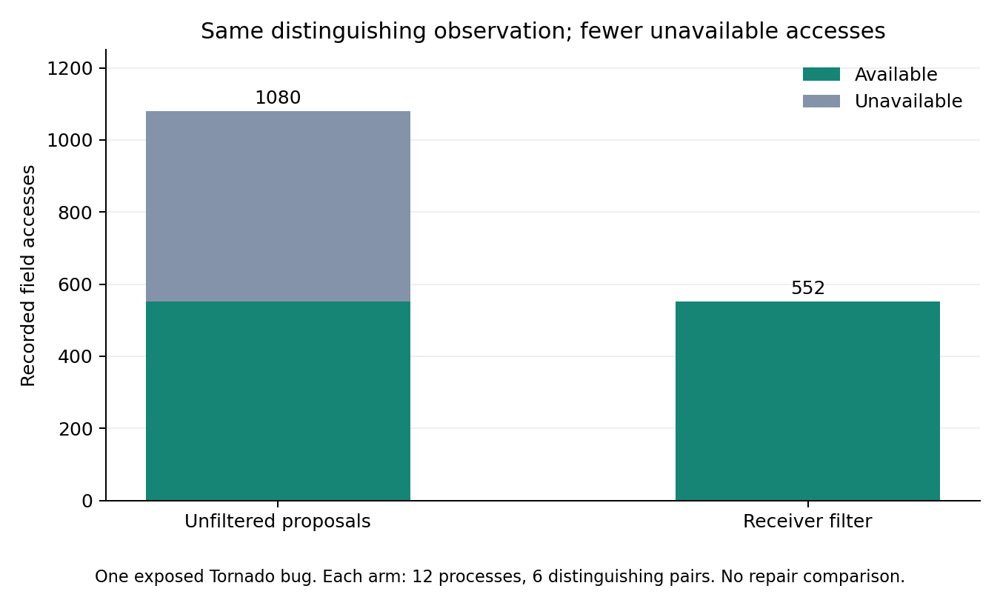

# Receiver filter: same signal, fewer unavailable accesses

October 13, 2026. Protocol frozen at `8d7ffaa` before replay. One previously
exposed Tornado bug; no model predictions, production patches or repair gains.



The actual AsyncIOLoop inheritance chain lets the filter retain four of the eight
earlier AST proposals. It preserves the shared registry and the receiver's three
container fields, while excluding four unrelated PollIOLoop instance fields.
All exclusion reasons and the buggy-source MRO inspection are recorded.

| Measurement | Unfiltered | Receiver-filtered |
| --- | ---: | ---: |
| Proposed fields | 8 | 4 |
| Probe subprocesses | 12 | 12 |
| Comparable buggy/reference pairs | 6 | 6 |
| Pairs with different observations | 6 | 6 |
| Field accesses | 1,080 | 552 |
| Unavailable accesses | 528 | 0 |

The filter removes **48.9% of field accesses** in this constructed invocation
schedule. This is not a reduction in tests, model calls or verified repair cost.
The retained registry distinguishes versions at both cycle counts in all three
repetitions. Repetitions are apparatus stability checks, not independent bugs.

Twenty-four fresh probe subprocesses completed, in addition to the single MRO
import process used during freeze. Probe subprocess elapsed time totals 25.362
seconds; complete runner time is 56.210 seconds. Receiver inspection plus filtering
took 1.117 seconds separately. Cached source/environment preparation and report
production are excluded. Fixed order and startup noise preclude a latency claim.
Reference target/neighbor tests were not rerun because no production source was
changed; their earlier results remain in the observer study. Snapshot identities
were checked against that study before this replay.

Keep this filter as a cheap baseline before learned ranking. Its same-access
recovery handles one deduplication hazard: a useful field initially attributed to
an unrelated class must remain if the receiver's source also assigns that access.
Dynamic injection, external helpers, aliases and receiver changes can still cause
incorrect exclusion. The single exposed case does not estimate those errors.

Next, measure candidate retention on additional development cases before enabling
the filter by default. The matched agent study must still verify actual repairs
under equal budgets, preserving native agent tools. No superiority over native
debugging, DeepEval or Laya is established here.

- [Methodology](METHODOLOGY.md), [protocol](protocol.json), [filter decisions](filter-decisions.json)
- [Detailed processes](results/run-001/processes.json), [summary](results/run-001/summary.json)

```powershell
python tools/study/receiver_study.py verify --name run-001
```
